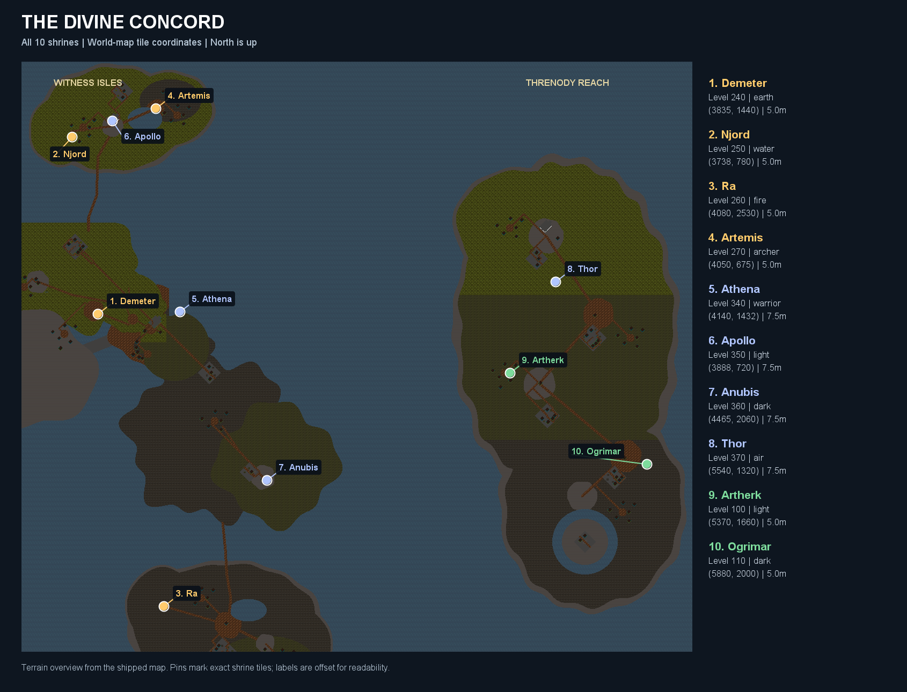

# The Divine Concord

Ten winged human embodiments answer the danger of Rhunor erasing divine names.
Artherk called the Concord; Ogrimar accepted because a nameless world gives him
nothing to conquer. Greek, Norse and Egyptian gods keep separate shrines in the
Witness Isles and Threnody Reach. They remain peaceful until challenged, then
test the challenger through their own school of combat. Defeated embodiments
reform at their shrine; the gods themselves are not killed by the trial.

The **Celestial Chronicler** stands near the Witness Isles arrival point at
**(4048,1488)**. Ask about **Concord**, **gods**, **tiers**, **scrolls**, or any
god's name for their story and directions. All coordinates below are world-map tiles.

| God | Tradition and role | Tier / level | Shrine | Respawn after death |
| --- | --- | --- | --- | --- |
| Demeter | Greek; earth caster, green regalia | Lesser / 240 | Oathstone Grove (3835,1440) | 5 minutes |
| Njord | Norse; water caster, blue regalia | Lesser / 250 | Moonwake western harbor (3738,780) | 5 minutes |
| Ra | Egyptian; fire caster, red regalia | Lesser / 260 | Emberglass western clearing (4080,2530) | 5 minutes |
| Artemis | Greek; archer, green regalia | Lesser / 270 | Moonwake eastern clearing (4050,675) | 5 minutes |
| Athena | Greek; warrior, golden plate | Elder / 340 | Eastern sanctuary approach (4140,1432) | 7.5 minutes |
| Apollo | Greek; light caster, ivory regalia | Elder / 350 | Moonwake temple court (3888,720) | 7.5 minutes |
| Anubis | Egyptian; dark caster, violet regalia | Elder / 360 | Sable Fen (4465,2060) | 7.5 minutes |
| Thor | Norse; air caster, golden storm regalia | Elder / 370 | Threnody northern approach (5540,1320) | 7.5 minutes |
| Artherk | Althean; light sovereign, white plate and wings | Seraph trial / 100 | Threnody western outer court (5370,1660) | 5 minutes |
| Ogrimar | Althean; dark sovereign, black plate and wings | Seraph trial / 110 | Threnody southeastern outer court (5880,2000) | 5 minutes |

The snapshot uses the shipped terrain overview and exact runtime shrine coordinates. Rebuild it with `com.perso.T4C.tools.DivineMapExporter`. Shrine positions and travel/story gates remain unchanged.

## Equipment and balance

Each god drops its own weapon, body armor or robe, boots, gauntlets, helm,
leggings, wings, necklace, ring and bracelet. Artherk and Ogrimar also drop a
warrior plate outfit and warblade alongside their caster regalia: **112 equipment
items** in total. The eight mythological gods retain an independent **2%** drop chance per piece. Artherk and Ogrimar instead roll once at **50%** for exactly one uniformly selected equipment piece. They follow
the existing item balance formulas and resistance rules, with no light resistance.
Artherk/Ogrimar, lesser and elder equipment requires roughly **180 / 380 / 650** in the
main attribute and **100 / 220 / 400** endurance on armor. Air uses paired
Intelligence/Wisdom requirements under the existing hybrid rule. Weapons have no
endurance requirement. Artherk and Ogrimar equipment follows the normal reusable equipment rules.

Artherk and Ogrimar each have **60,000 HP**, with damage bands of **50–100**
and **60–120** respectively. Lesser gods have **120,000 HP** and **400–800**
damage; elder gods have **400,000 HP** and **750–1,500** damage before defenses.
These are melee damage bands; melee dice start one point above their lower end.
Elemental judgments use separate boss ranges, with stronger lesser and elder tiers,
and are reduced by the matching elemental resistance. Their current limits are
published on each god's compendium page. Artherk and Ogrimar retain their original
lower Seraph-trial spell damage. The ordinary hunting-caster reduction remains in
place for other creatures. Divine fights aim for moderate pressure: a strong aura
helps, while occasional active healing and attention to the elder debuffs matter.
Elemental gods resist their
own school more strongly. Artemis uses a physical ranged arrow trial; Athena uses
melee; the six caster schools have distinct elemental attacks and visuals.
Gods can be killed with melee, arrows or offensive spells, and retaliate after being challenged. Their outline uses current health, starting green at full health and shifting toward red as health falls. Gods have no aggressive clan behavior and cannot be tamed. Existing hunting
refill shortcuts do not apply to these bosses.
Each shrine contains one embodiment, independent of the ordinary monster spawn multiplier.

Athena, Apollo, Anubis and Thor can cast **Divine Armor Melt** (-25% total AC)
and **Divine Curse** (-40% healing received, including potions and regeneration).
Athena also uses **Divine Enfeeblement** (-20% of unbuffed Attack, Archery and
Dodge); the three elder casters instead use **Divine Exposure** (-20% of each
unbuffed elemental resistance). Each effect lasts **20 seconds**, refreshes
without stacking, and displays its name and remaining duration in the active
effects. A shared **10-second** interval prevents consecutive debuff spam by
the same god. These casts replace a normal attack and deal no direct damage.
Shrine cooldowns are saved on the character, so changing maps or reloading cannot
restart a defeated god's trial before its timer expires.

Every Artherk defeat guarantees **exactly one** randomly selected **Heart, Soul or Will of Artherk**. Every Ogrimar defeat guarantees **exactly one** randomly selected **Blood, Bones or Skull of Ogrimar**. Each component has equal selection weight. A separate **50%** roll awards one piece from that god's equipment set, and an independent **1%** roll awards its return scroll. No gods drop health potions or mana recovery supplies, including automatic level-300 utility drops. These are the same quest items consumed by the existing
good and evil quest paths.

## Bound Return Scrolls

Every god has an independent **1%** chance to drop its own Bound Return Scroll.
Each scroll returns to a nearby landing point three tiles east and south of its
shrine. The scroll is reusable with a five-second use cooldown, has zero weight,
cannot be dropped, junked, sold or deposited in either storage system, and remains
in the character's backpack after death, saving/loading and rebirth. One scroll
per god can be carried. It does not provide combat protection at the destination.

## Content maintenance

`tools/generate_divine_pantheon.py` reproduces the equipment JSON, monster entry
classes and English names. Shared combat, loot, scrolls and travel spells live
in `com.perso.T4C.divine`. Item IDs 55000–55999, spell IDs 18000–18009 and
18100–18109 and 18200–18203, and boost IDs 50000–51999 are reserved for this content line.

`DivineEquipmentPaletteGenerator` derives eight complete color families from the
existing equipment sprites, preserving frame geometry, offsets and alpha.
Palettes 90/91 are white/black; 92–97 cover green, blue, red, gold, violet and ivory.
Both male and female equipment shapes and inventory icons are packed. The
generator can be rerun after changing its colors without touching map terrain.

## Verification

`mvn -B test` passed all **609 tests** on 2026-10-24, including deterministic per-kill loot probability boundaries, recovery-loot exclusions, and a lethal Mountain's Fist hit on Anubis. The checks cover registry
references, numeric identities, equipment balance and sprite availability, shrine
and return-point reachability, bound-scroll storage/death/save/rebirth behavior,
and repeated respawns. The roster was also rendered through the game's OpenGL
humanoid renderer for visual inspection; see the [sprite preview](images/divine-pantheon-preview.png).
