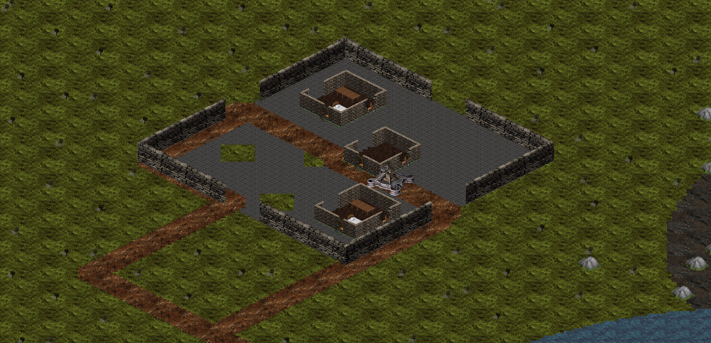
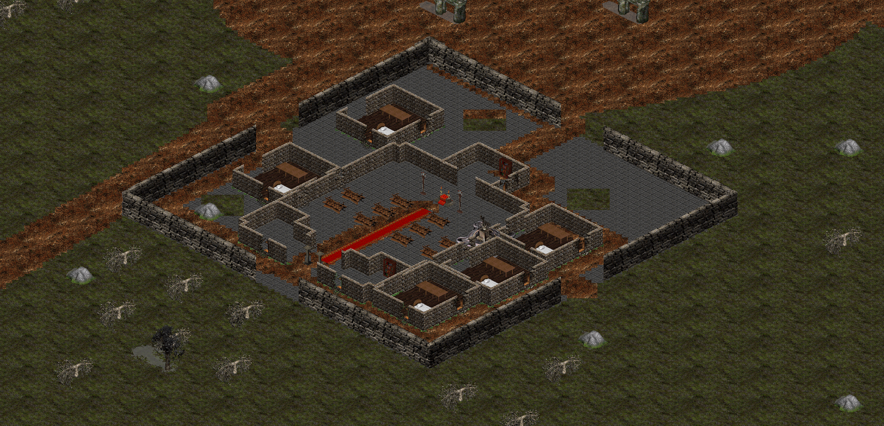

# New-world settlement and hunting pass

The Witness Isles, Moonwake Shoals, Emberglass Crown, Threnody Reach and Kraanhold's marches now have a connected settlement layer built from the game's existing castle, temple, cottage, storehouse, orchard and landscape art.

## Shipped changes

- Twelve stone fortifications with open gates, courtyard keeps, barracks and road connections.
- 134 additional buildings across castles and fifteen outlying settlements.
- 11,357 scenery anchors: woodland, deadland detail, rocks, orchards, wells and fountains.
- 420 authored hunting points across twelve monster types, with small garrisons inside enemy-held castles. The Verdant Warden's three existing escorts are retained separately.
- Protected arrival points, NPC approaches and divine shrines. New enemies stay away from the sanctuary footprint and quest witnesses; large ghost canopies stay clear of encounters.
- Wider quest geofences matching the hunting districts, without changing quest IDs, progress flags, kill totals or story gates. The Wilds objective excludes the Verdant Warden's escorts.
- The Hollow Dawn moat remains a physical gate. Normal hunting spawns stay outside the sealed arena.

The Celestial Chronicler's quoted **settlements** topic explains the new landmarks in game. Buildings use open, visible doorways and solid wall collision; they are map structures, not copied NPCs or imported stair/teleport links.

## Fortifications

| Landmark | World tile coordinates |
| --- | --- |
| Oathwood Castle | (3750, 1190) |
| Sanctuary East Keep | (4250, 1660) |
| Moonwake Castle | (3925, 610) |
| Emberglass Citadel | (4300, 2700) |
| Sable Fen Watch | (4400, 2030) |
| Threnody Gatehouse | (5470, 1235) |
| Bellward Castle | (5680, 1530) |
| Black Oath Keep | (5510, 1820) |
| Regent's Bastion | (5760, 2050) |
| Hollow Crown | (5650, 2290) |
| Marchwarden Castle | (2400, 2470) |
| Drakewatch Bastion | (2650, 2880) |

## Runtime previews

These are captures through the game's terrain/decor renderer, not concept art.

## Authoring and verification

`assets/maps/worldmap/world-detail-layout.json` records the actual castle, building and hunting coordinates. `RegionalWorldDetailBuilder` authored and validated the terrain; `tools/apply_regional_spawn_layout.py` writes the validated hunting points into the twelve monster classes. Existing boss, god and NPC anchors remain in place.

The map builder is a one-time detail pass and refuses to paint over its own finished map. Rebuilding requires the saved source map under `target/world-detail-backup` and `--rebuild-from-backup`; actor placements are authoring inputs too. It writes staged map/decor/collision files only after validating the layout, then copies the validated result into the world assets. Do not rerun the older island painters over this finished detailing.

A semantic comparison against the source backup verified **11,647,190 protected tiles unchanged** in ground, decor, offsets, scale, depth and collision. All edits are inside the new-land masks.

Integration checks cover castle gates, real building walls and doorways, connected hunting points, source/registry agreement, quest geofences, shrine and travel access, sanctuary protection, witness separation, canopy visibility and the sealed arena.

`mvn -B test` passed all **611 tests** on 2026-10-24. Native OpenGL terrain/decor captures were inspected for Moonwake, Bellward, an orchard hamlet and Kraanhold.

[Orchard hamlet preview](images/world-detail-hamlet.png) · [Kraanhold preview](images/world-detail-kraanhold.png)
